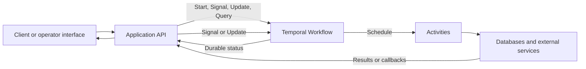

# Juniper Salon Product Requirements and Temporal Architecture

This document preserves the full requirements and architecture framework and records the approved thin vertical slice. The implementation contract is the [Juniper Salon Open Slot MVP Specification](approved-mvp-spec.md); the broader framework below is frozen reference material and must not expand MVP scope.

## Approved MVP architecture

The approved slice runs one `OpenSlotWorkflow` per open slot. Its stable Workflow ID is `open-slot/{slotId}`, which rejects duplicate starts and lets the API return the existing execution. The Workflow receives immutable slot details and waitlist fixtures, deterministically filters fixtures by explicit service, stylist or time fit, and availability fields, sorts eligible clients by earliest `joinedAt` with `clientId` as a deterministic tie-breaker, and permits only one active offer at a time.

The Workflow calls a simulated `sendOffer` Activity with bounded retries, then waits on a durable timer configured at start: 15 minutes for production mode or approximately 10 seconds for the demo. `accept`, `decline`, and `skip` are Workflow Updates with idempotent command IDs and explicit results. `getOpenSlotStatus` is a Query that returns the current client, offer deadline, ordered history, last error, phase, and terminal state.

A successful accept calls the idempotent `bookSlot` Activity using `booking:{slotId}` and completes the Workflow as `filled`. A late accept is resolved from the final Workflow result as `already-filled`; it performs no booking or waitlist-removal side effect. Decline, skip, or timer expiry records an outcome and advances to the next client. Exhausting the eligible snapshot completes the Workflow as `unfilled`.

Simulated send failures remain visible in Temporal history. Exhausted send retries set `send-failed` and `lastError`; `skip` records the failure and advances without losing history. Booking failures retain the claimed client and use the same idempotency key on a repeated accept.

Real SMS, calendar or spreadsheet integration, authentication and authorization, deployment, scheduling optimization, child Workflows, and rules engines are explicitly excluded.

### Approved decisions

| Decision | Approved choice |
| --- | --- |
| Workflow boundary | One `OpenSlotWorkflow` per open slot |
| Eligibility | Pure predicate over supplied fixture fields; no rules engine |
| Ordering | Earliest `joinedAt`, then `clientId` for deterministic ties |
| Concurrency | One active offer and one response timer at a time |
| Commands | Workflow Updates for `accept`, `decline`, and `skip` |
| Status | `getOpenSlotStatus` Query |
| Offer duration | `900000` ms production; about `10000` ms demo, passed in Workflow input |
| Notification boundary | Simulated `sendOffer` Activity with three bounded attempts |
| Booking boundary | Simulated process-local `bookSlot` Activity keyed by slot; production requires a durable unique key |
| Duplicate start | Reject conflict and return the existing slot execution |
| Late accept | Return `already-filled`; make no booking or waitlist-removal change |
| Send failure recovery | Preserve error/history; retry automatically, then allow skip after exhaustion |
| Terminal outcomes | `filled` or `unfilled` |

### Approved requirement traceability

| Requirement ID | Source requirements | Required behavior | Acceptance evidence |
| --- | --- | --- | --- |
| FR-001 | RQ-01, RQ-02, RQ-03 | Filter by explicit service, stylist or time fit, and availability, then offer in earliest-joined order | Test verifies slot fields, excluded fixtures, ordering, and deterministic tie-break |
| FR-002 | RQ-04 | Maintain no more than one active offer | Query and Workflow history show one current client |
| FR-003 | RQ-05, RQ-07 | Advance on decline, skip, or durable timeout | Time-skipping and Update tests verify each path |
| FR-004 | RQ-06, RQ-09 | Book once on acceptance | Repeated accept and Activity retry produce one booking |
| FR-005 | RQ-09, RQ-10 | Reject duplicate slot starts | Stable Workflow ID resolves to the existing execution |
| FR-006 | RQ-08, RQ-11 | Return `already-filled` for a late acceptance | API test verifies response and unchanged losing-client waitlist state |
| FR-007 | RQ-12 | Expose current client, deadline, history, last error, and terminal state | Query contract test verifies every field |
| FR-008 | RQ-10 | Recover visibly from simulated send failure | Retry and exhausted-retry tests verify history, error, and skip recovery |

## Frozen reference framework

The remaining sections are retained as design guidance. Candidate items are not approved MVP scope unless repeated in the approved architecture above.

## Evidence and decision status

Use these labels consistently:

- **Validated finding:** directly supported by approved customer evidence.
- **Derived requirement:** a product requirement traceable to one or more validated findings.
- **Architecture decision:** an approved technical choice with stated rationale and consequences.
- **Candidate:** a proposal that must not be represented as approved behavior.
- **Open question:** information required to make or validate a decision.

### Source register

| Source ID | Source | Date | Evidence owner | Approval status | Scope and limitations |
| --- | --- | --- | --- | --- | --- |
| SRC-001 | `REQUIREMENTS_HANDOFF.md` plus approved architecture direction | 2026-10-05 | Program coordination | Approved for MVP | Defines the open-slot vertical slice, prototype assumptions, and explicit exclusions; the customer-readable Business Needs artifact must be reconciled separately. |

### Finding register

| Finding ID | Validated finding | Source IDs | Confidence | Product implication | Open questions |
| --- | --- | --- | --- | --- | --- |
| F-001 | Fill one open slot by offering it to eligible clients in earliest-joined order, one client at a time | SRC-001 | Approved for MVP | Use one durable slot Workflow with a sequential offer loop | None for MVP boundary |
| F-002 | Offers need a durable 15-minute response window and a short demonstration configuration | SRC-001 | Approved for MVP | Pass the resolved duration in Workflow input and use a durable timer | Production configuration is not deployed in this assessment |
| F-003 | Duplicate starts, delivery failures, booking retries, and late acceptance must not create duplicate or conflicting outcomes | SRC-001 | Approved for MVP | Stable Workflow ID, bounded Activity retries, idempotent booking, explicit terminal response | None for MVP boundary |

## Product outcomes and scope

### Problem statement

Pending validated customer evidence.

### Target users and roles

Do not infer roles from the salon domain alone. Add a role only when evidence or approved product scope establishes that it interacts with the system.

| Role ID | Role | Evidence | Goals | Permissions or constraints |
| --- | --- | --- | --- | --- |
| ROLE-001 | Pending | Pending | Pending | Pending |

### Desired outcomes

| Outcome ID | Outcome | Evidence | Measurement | Target | Evaluation window |
| --- | --- | --- | --- | --- | --- |
| OUT-001 | Pending | Pending | Pending | Pending | Pending |

### In scope

Pending approved scope.

### Out of scope

Pending approved scope. Record explicit exclusions to prevent prototype demonstrations from implying unsupported product commitments.

## Customer journeys

Create one journey per validated user goal. Each step must identify the user intent, system response, failure path, and recovery path.

### Journey template

**Journey ID:** J-001  
**User and goal:** Pending  
**Trigger:** Pending  
**Preconditions:** Pending  
**Successful outcome:** Pending

| Step | User intent or external event | Product behavior | Persisted state | Failure and recovery | Evidence |
| --- | --- | --- | --- | --- | --- |
| 1 | Pending | Pending | Pending | Pending | Pending |

### Cross-journey rules

- A user-visible status must reflect durable workflow state, not an in-memory request state.
- Repeated requests must not create duplicate business effects.
- Recovery behavior must explain what the user sees after a timeout, process restart, worker outage, or duplicate external event.
- Cancellation semantics must distinguish stopping future work from reversing effects already completed.

## Functional requirements

Write each requirement as an observable behavior. Trace it to customer evidence and a journey step before marking it approved.

| Requirement ID | Requirement | Priority | Finding IDs | Journey steps | Acceptance criteria | Status |
| --- | --- | --- | --- | --- | --- | --- |
| FR-001 | Pending | Pending | Pending | Pending | Pending | Draft |

### Requirement quality checks

- The actor, trigger, and observable outcome are explicit.
- Preconditions and authorization rules are stated.
- Success, partial success, retry, timeout, duplicate, cancellation, and terminal failure behavior are covered when applicable.
- Acceptance criteria can be demonstrated or tested without relying on internal implementation details.
- The requirement does not prescribe Temporal unless durability or orchestration is part of the user-visible contract.

## Non-functional requirements

Targets remain pending until supported by product expectations or prototype constraints.

| Requirement ID | Quality attribute | Required behavior or target | Measurement method | Scope | Evidence or rationale | Status |
| --- | --- | --- | --- | --- | --- | --- |
| NFR-001 | Reliability | Pending | Pending | Pending | Pending | Draft |
| NFR-002 | Recovery | Pending | Pending | Pending | Pending | Draft |
| NFR-003 | Security and privacy | Pending | Pending | Pending | Pending | Draft |
| NFR-004 | Observability | Pending | Pending | Pending | Pending | Draft |
| NFR-005 | Performance | Pending | Pending | Pending | Pending | Draft |
| NFR-006 | Accessibility | Pending | Pending | Pending | Pending | Draft |

### Candidate engineering constraints

These constraints are candidates until confirmed against the starter repository and assessment expectations:

- Workflow code must remain deterministic and replay-safe.
- External I/O must occur in Activities, not Workflow code.
- Business identifiers and idempotency keys must be stable across retries.
- Workflow history growth must be bounded for long-lived executions.
- Logs and search attributes must avoid sensitive customer content unless explicitly permitted.
- Prototype failure injection must be distinguishable from production error handling.

## Edge cases and recovery

Add or remove cases based on validated journeys. The list below is a review checklist, not a claim that each case is in scope.

| Edge case ID | Candidate condition | Expected user-visible behavior | Durable state rule | Recovery or compensation | Decision status |
| --- | --- | --- | --- | --- | --- |
| EC-001 | Duplicate command or event | One logical outcome | Deduplicate by a stable business key | Return the existing result or no-op safely | Candidate |
| EC-002 | Activity timeout | Pending | Workflow remains authoritative | Retry, escalate, or fail according to the approved retry policy | Candidate |
| EC-003 | Worker process restarts | No lost progress | Reconstruct state through Workflow replay | Resume scheduled work | Candidate |
| EC-004 | User cancellation during external work | Pending | Record cancellation request and completed effects | Stop cancellable work; compensate only where approved | Candidate |
| EC-005 | External dependency unavailable | Pending | Preserve durable intent | Backoff, retry, surface delayed status, or escalate | Candidate |
| EC-006 | Conflicting update while work is active | Pending | Apply an explicit ordering or rejection rule | Signal, Update, queue, or reject according to policy | Candidate |
| EC-007 | Timer fires after state changed | No stale action | Recheck workflow state after wake-up | No-op or reschedule deterministically | Candidate |
| EC-008 | Workflow history approaches limit | No user-visible interruption | Carry forward required state | Continue As New when the approved design warrants it | Candidate |
| EC-009 | Partial external success | Pending | Record the last confirmed business milestone | Retry idempotently or run an approved compensation | Candidate |
| EC-010 | Invalid or unauthorized request | Clear rejection with no side effect | Do not mutate workflow state | Return a stable error category | Candidate |

## Starter implementation baseline

The official starter is a neutral connectivity demonstration and is not evidence of Juniper Salon requirements. The following behavior was verified by source inspection on 2026-10-05.

| Area | Implemented behavior | Current limitation for the customer prototype |
| --- | --- | --- |
| Workflow | `demoWorkflow` moves from `started` to `waiting` to `complete` | The lifecycle is intentionally unrelated to the customer process |
| Signal | `continueDemo` releases a durable condition | No domain command, validation, authorization, or duplicate handling is defined |
| Query | `getDemoStatus` returns the current in-Workflow status | No approved customer state model exists |
| Workflow ID | The API generates a random UUID for each start | Repeating the same business request starts a separate execution; no business idempotency policy exists |
| Worker | One Worker polls the `assessment-starter` Task Queue | No Activities are registered and no workload-specific queue decision has been made |
| API | Express starts, queries, and signals the Workflow | Errors are returned as generic HTTP 500 responses and there is no domain validation or authorization |
| Browser | The page starts the demo, polls status, and sends the Signal | The interface represents only the neutral demo and must not be presented as customer functionality |
| Local Temporal service | Docker Compose runs Temporal with a SQLite database on a named volume | This establishes local durability for demonstration, not production availability or operations |
| Automated test | A time-skipping Workflow test starts, signals, and verifies completion | Timers, Activity retries, failure recovery, cancellation, idempotency, and replay compatibility are not tested |

### Starter-to-product replacement boundary

- Replace the neutral `DemoStatus`, message names, Workflow, API routes, browser copy, and test scenario only after the requirements handoff is approved.
- Retain the proven local development shape where useful: Temporal Client, Worker, Task Queue, browser API, time-skipping test environment, and local Temporal UI.
- Add Activities only for approved external effects. Do not manufacture an integration merely to demonstrate Temporal.
- Keep any deliberate failure switches, shortened test timers, fixtures, and mocks behind explicit prototype or test controls.
- Do not claim that Docker-local persistence, a single Worker, or the generic API error handler meets production reliability, security, or operability needs.

## Temporal architecture candidates

Temporal should own processes that require durable coordination across time, retries, asynchronous events, or failures. Ordinary synchronous validation and simple database CRUD should remain outside a Workflow unless evidence shows that durable orchestration adds product value.

### Candidate component boundaries

This diagram is conceptual. Actual components and integrations must be confirmed from the starter repository and approved product scope.

### Primitive selection guide

| Need | Candidate Temporal primitive | Use when | Avoid or reconsider when | Decision required |
| --- | --- | --- | --- | --- |
| Durable business process | Workflow | The process must survive restarts and coordinate multiple steps or waits | A single stateless request is sufficient | Identify the business lifecycle and Workflow ID policy |
| External I/O or nondeterministic work | Activity | Calling a database, service, model, notification provider, or filesystem | Logic is deterministic state transition only | Define timeouts, retry policy, idempotency, and result size |
| Time-based wait | Durable Timer | A deadline, delay, reminder, grace period, or scheduled follow-up is product behavior | Wall-clock sleep occurs inside an Activity or request handler | Define what happens if state changes before the timer fires |
| Asynchronous external event | Signal | The sender does not need a synchronous validated result | The caller requires immediate acceptance or rejection with a result | Define ordering, deduplication, and unknown-Workflow behavior |
| Validated synchronous mutation | Workflow Update | The caller needs durable acceptance and a result from Workflow logic | Fire-and-forget delivery is sufficient | Define validators, timeout behavior, and client retry semantics |
| Read-only workflow state | Query | The UI or operator needs current state without mutation | The value must be sourced from an external system | Define eventual-consistency expectations and fallback status |
| Reusable child lifecycle | Child Workflow | A sub-process needs independent retries, visibility, or lifecycle | An Activity or local function is sufficient | Define parent close policy and cancellation propagation |
| Bounded history | Continue As New | A long-lived Workflow accumulates repeated events | Execution is short-lived and bounded | Define rollover threshold and carried state |
| Human or operator intervention | Signal or Update plus Timer | Work pauses for approval, correction, or escalation | No durable wait is required | Define authorization, deadline, and default outcome |
| Undo after completed side effects | Compensation Activity | The business permits a specific reversal | The effect is irreversible or a forward fix is safer | Define compensation order, idempotency, and failure handling |

### Candidate workflow shape

Do not name a domain-specific Workflow until journeys are validated. For each approved durable process, specify:

| Design element | Required decision |
| --- | --- |
| Workflow type | Stable technical name tied to one business lifecycle |
| Workflow ID | Business key, collision policy, and reuse/conflict policy |
| Input | Minimal immutable start data and schema version |
| State | Durable business milestones exposed to Queries |
| Activities | External effects with ownership and idempotency strategy |
| Timers | Business deadline, wake-up condition, and stale-timer behavior |
| Signals and Updates | Command schema, validation, authorization, ordering, and deduplication |
| Child Workflows | Lifecycle boundary, cancellation propagation, and parent close policy |
| Retry policy | Per-error retryability, intervals, backoff, maximum attempts, and escalation |
| Cancellation | Accepted states, cleanup behavior, heartbeat use, and completed-effect policy |
| Compensation | Explicit reversals, execution order, and terminal failure handling |
| Completion | Terminal states and result returned to callers |
| Continue As New | Threshold and exact state carried forward |
| Versioning | Safe replay strategy for in-flight Workflow histories |
| Observability | Search attributes, memo, metrics, logs, and sensitive-data rules |

## Reliability policies

### Activity retries

Retries must be tailored to the failure mode rather than applied as one global default.

| Failure category | Candidate handling | Notes |
| --- | --- | --- |
| Transient dependency failure | Exponential backoff with bounded attempts or elapsed time | Exact values pending dependency behavior and user tolerance |
| Rate limit | Retry using provider guidance where available | Prevent retry storms and preserve deadline awareness |
| Validation or authorization failure | Non-retryable failure | Surface a stable business error without repeating the side effect |
| Unknown outcome after request submission | Reconcile by idempotency key or provider lookup before retry | Prevent duplicate business effects |
| Long-running work | Heartbeat progress and cancellation details | Heartbeat interval and payload pending Activity design |

Every Activity must declare `StartToClose` or `ScheduleToClose` as appropriate. Long-running Activities should also declare `HeartbeatTimeout`; short external calls may require `ScheduleToStart` only when queue latency is itself actionable.

### Idempotency

- Derive an idempotency key from the durable business operation, not from an Activity attempt.
- Persist or pass the same key on every retry.
- Prefer an atomic uniqueness constraint or provider-supported idempotency mechanism.
- If the external system cannot guarantee idempotency, reconcile current state before repeating the effect.
- Treat Workflow replay safety and Activity idempotency as separate requirements.

### Cancellation and compensation

- Define cancellation as a business state transition, not only a technical exception.
- Propagate cancellation to child work only when that matches the business lifecycle.
- Use Activity heartbeats for prompt cancellation of long-running work.
- Record completed irreversible effects and explain them to the caller.
- Run compensations only when explicitly designed, idempotent, and safer than forward recovery.

### Recovery and operator action

- Workflow state is the source of truth for orchestration progress.
- Operator actions must use explicit Signals or Updates rather than direct state mutation.
- Manual retry, correction, or override operations require authorization and an audit trail.
- Reset, termination, and manual completion are operational tools, not normal product flows; demonstrate them only when their implications are explained.

## Prototype truthfulness

The final assessment must clearly separate implemented behavior from simulated behavior.

| Capability | Classification | Evidence required |
| --- | --- | --- |
| Real end-to-end behavior | Implemented | Executable path, persisted outcome, and repeatable demonstration |
| Real Workflow with stubbed Activity | Partially implemented | Workflow history plus explicit label identifying the stub |
| Simulated external integration | Simulated | Visible label, deterministic fixture or mock description, and no claim of live connectivity |
| Proposed future behavior | Proposed | Architecture or requirement only; excluded from the working demo |

For each demonstration scenario, record:

- Which Workflow, Activities, timers, Signals, Updates, and Queries actually execute.
- Which dependencies are real, local, mocked, or manually triggered.
- Which failure is naturally produced versus deliberately injected.
- What durable evidence proves recovery, deduplication, cancellation, or timer behavior.
- What the prototype does not establish about production readiness, scale, security, or integration quality.

## Architecture decision log

| Decision ID | Decision | Status | Evidence and rationale | Alternatives considered | Consequences | Owner and date |
| --- | --- | --- | --- | --- | --- | --- |
| ADR-001 | Select the primary durable business lifecycle | Open | Requires validated journeys | Pending | Determines Workflow boundary and ID | Pending |
| ADR-002 | Select Signal versus Update for each external command | Open | Requires caller response needs and validation rules | Signal; Update; synchronous API only | Determines delivery and response semantics | Pending |
| ADR-003 | Select retry and timeout policies per Activity | Open | Requires dependency behavior and user tolerance | Bounded retry; elapsed-time limit; operator escalation | Determines latency and failure handling | Pending |
| ADR-004 | Select idempotency strategy per external effect | Open | Requires integration capabilities | Unique constraint; provider key; state reconciliation | Determines duplicate-risk controls | Pending |
| ADR-005 | Select cancellation and compensation behavior | Open | Requires business reversibility rules | Stop future work; compensate; forward recovery | Determines user expectations after partial success | Pending |
| ADR-006 | Select history rollover policy | Open | Requires lifecycle duration and event volume | Complete normally; Continue As New | Determines long-running Workflow operation | Pending |

## Validation and acceptance plan

### Product validation

- Every approved requirement traces to at least one validated finding or explicit assessment constraint.
- Every journey has a successful path, failure path, and recovery path.
- Priorities reflect customer value and prototype feasibility without conflating the two.
- Open questions that can change Workflow boundaries or semantics are resolved before implementation is treated as final.

### Architecture validation

- Replay tests cover deterministic Workflow evolution.
- Activity tests cover retryable, non-retryable, timeout, cancellation, and unknown-outcome cases.
- Integration tests demonstrate stable Workflow IDs and duplicate-request behavior.
- Time-skipping tests exercise timers and deadlines without real waiting.
- Recovery tests restart workers during active executions and verify completion from durable state.
- The demo captures Workflow history or UI evidence for every claimed Temporal behavior.

## Open inputs required

1. Approved Lena findings with source references and confidence or validation status.
2. Official starter repository structure, existing behavior, and assessment constraints.
3. Required prototype scenarios and expected evaluation criteria.
4. Available external systems and which must be real versus simulated.
5. Data sensitivity, authorization, and retention expectations.
6. User-visible latency, deadline, notification, and cancellation expectations.

